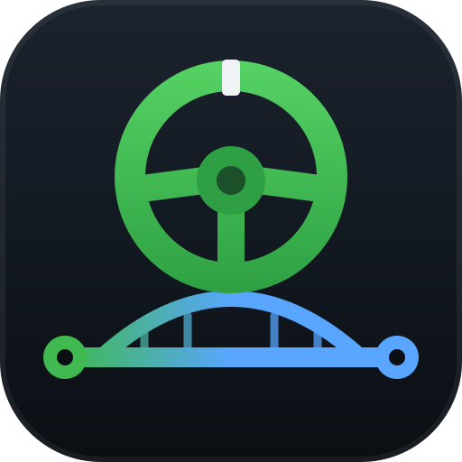
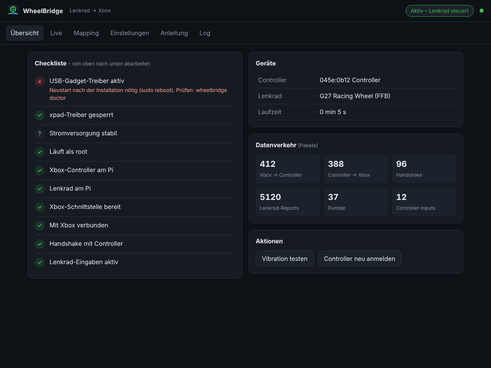
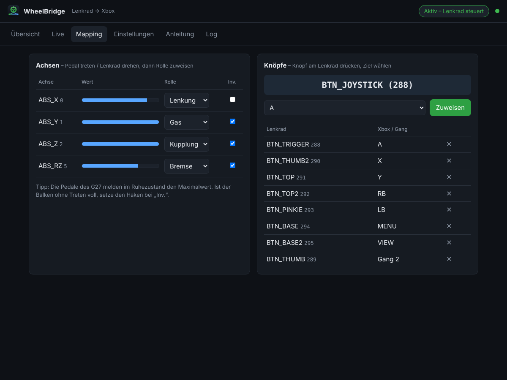
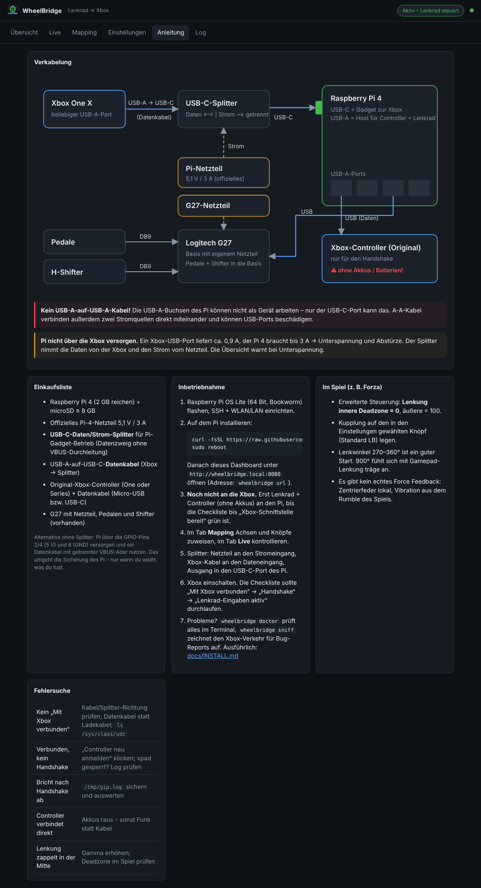

<p align="center"></p>
<h1 align="center">WheelBridge</h1>

<p align="center">
  <b>Alte PC-Lenkräder an aktuellen Xbox-Konsolen, mit einem Raspberry Pi 4.</b><br>
  Logitech G27 an der Xbox One X: Plug &amp; Play mit Web-Dashboard.
</p>

<p align="center">
  <a href="https://github.com/W0rkingChr1s/WheelBridge/actions/workflows/ci.yml"></a>
  <a href="https://github.com/W0rkingChr1s/WheelBridge/releases"></a>
  <a href="LICENSE"></a>
  
  
  
</p>

<p align="center">
  <a href="#installation">Installation</a> ·
  <a href="docs/INSTALL.md">Anleitung</a> ·
  <a href="docs/VERKABELUNG.md">Verkabelung</a> ·
  <a href="#features">Features</a> ·
  <a href="CHANGELOG.md">Changelog</a> ·
  <a href="CONTRIBUTING.md">Mitmachen</a>
</p>



> [!WARNING]
> **Experimentell.** Protokoll-Logik, Mapping, Dashboard und Installer sind getestet, der Betrieb an einer echten Xbox noch nicht (siehe [Offene Punkte](#offene-punkte)). Testberichte sind sehr willkommen: [Lenkrad-Testbericht](https://github.com/W0rkingChr1s/WheelBridge/issues/new?template=wheel_report.md).

## Wie es funktioniert

```
Xbox ──USB-C (Gadget)──▶ Pi 4 ──USB-A──▶ Original-Xbox-Controller   (nur Auth-Handshake)
                              └─USB-A──▶ Logitech G27
```

Xbox One und Series akzeptieren nur Controller mit Microsofts Sicherheitschip. Der Pi spielt deshalb **Man-in-the-Middle**: Er klont die USB-Identität eines echten Controllers und reicht den gesamten GIP-Verkehr roh durch, also Announce, Identify, Auth und ACKs. Den Handshake beantwortet so der echte Chip. Zwei Dinge greift der Pi ab:

- **Input-Reports** des Controllers werden durch Lenkraddaten ersetzt oder mit ihnen gemischt.
- **Rumble-Befehle** der Xbox gehen als Vibration ans Lenkrad.

**Erwartung realistisch halten:** Die Xbox sieht ein Gamepad. Lenkung liegt auf dem linken Stick, Gas und Bremse auf den Triggern, die Kupplung ist ein Knopf, der H-Shifter wird optional sequentiell. Echtes, spielgesteuertes Force Feedback gibt es so nicht. Der Pi erzeugt eine Zentrierfeder und Vibration.

## Features

- Ein-Zeilen-Installer mit Update/Deinstallation, CLI und Systemcheck (`wheelbridge doctor`)
- Web-Dashboard ohne externe Abhängigkeiten (`http://<pi-ip>:8080`)
  - **Live-Checkliste** für die Inbetriebnahme: Treiber, Strom, Geräte, Xbox, Handshake
  - **Live-Ansicht**: Lenkwinkel, Pedale, Knöpfe, Vibration
  - **Mapping-Assistent**: Pedal treten bzw. Knopf drücken und dann zuweisen
  - Einstellungen live änderbar (Lenkwinkel, Zentrierfeder, Gamma, Deadzones, Rumble …)
  - Verkabelungsanleitung mit Diagramm, Log-Ansicht
- Lenkwinkel-Anschlag in Hardware über `lg4ff` (das Lenkrad stoppt physisch am Stick-Maximum)
- H-Shifter → sequentielle Schaltpulse
- Paket-Mitschnitt (`--sniff`) zur Protokoll-Fehlersuche
- Nur Debian-Pakete: `python3-evdev`, `python3-usb`

| Mapping | Anleitung |
|---|---|
|  |  |

## Verkabelung, kurz

**Ausführlich:** [docs/VERKABELUNG.md](docs/VERKABELUNG.md) und im Dashboard.

- Xbox (USB-A) → **USB-A-auf-USB-C-Datenkabel** → Splitter → **USB-C** des Pi
- **Kein A-auf-A-Kabel.** Die USB-A-Ports des Pi können nicht als Gerät arbeiten.
- Pi-Strom über den Splitter vom eigenen Netzteil, **nicht** aus der Xbox
- Controller **ohne Akkus** per Kabel an den Pi

## Installation

Auf einem Raspberry Pi 4 mit Raspberry Pi OS Lite (64 Bit, Bookworm):

```bash
curl -fsSL https://raw.githubusercontent.com/W0rkingChr1s/WheelBridge/main/install.sh | sudo bash
```

Danach einmal neu starten, Lenkrad und Controller (ohne Akkus) an den Pi stecken und das Dashboard öffnen (`wheelbridge url`). Die Checkliste dort führt durch den Rest.

📖 **Ausführliche Anleitung:** [docs/INSTALL.md](docs/INSTALL.md): SD-Karte vorbereiten, Kalibrierung, Xbox-Anschluss, Update, Deinstallation, Fehlersuche.

```bash
wheelbridge doctor     # Systemcheck mit Lösungshinweisen
wheelbridge logs       # Log live
wheelbridge sniff      # Mitschnitt für Bug-Reports
wheelbridge update     # aktualisieren (Konfiguration bleibt)
```

## Konfiguration

- `/etc/wheelbridge/config.toml`: dokumentierte Standardwerte. Updates überschreiben sie nie (`wheelbridge config`).
- `/var/lib/wheelbridge/settings.json`: Änderungen aus dem Dashboard, überschreiben `config.toml`. Mit `wheelbridge reset` verwirfst du sie.
- Ohne Dashboard: `wheelbridge probe` zeigt Achsen- und Knopfcodes im Terminal, `--usb` die Descriptors des Controllers.

> [!CAUTION]
> **Sicherheit:** Das Dashboard hat keine Anmeldung. Betreib es nur im eigenen Netz, oder setz `[web] bind = "127.0.0.1"` und greif per SSH-Tunnel zu.

## Offene Punkte

| Punkt | Risiko | Klärung |
|---|---|---|
| USB-Descriptors: nur das GIP-Interface, ohne Audio/Bulk wie beim Original | Xbox bricht ggf. nach `IDENTIFY` ab | `wheelbridge probe --usb` + `wheelbridge sniff`, dann ggf. Interfaces ergänzen |
| Sequenznummern der injizierten Reports | Trennung nach dem Handshake | Mitschnitt |
| Microsoft blockiert per Firmware gelegentlich Zubehör | Funktion kann durch Updates brechen | Original-Controller als Auth-Partner nutzen |

## Projektstruktur

```
bridge/main.py        Supervisor, Relay-Threads, Report-Sender, Status
bridge/web.py         HTTP-Server, JSON-API, Server-Sent-Events
bridge/web/index.html Dashboard (Vanilla JS, keine CDNs)
bridge/gip.py         GIP-Pakete (Input/Rumble)
bridge/ffs.py         FunctionFS-Descriptors inkl. MS-OS "XGIP10"
bridge/gadget.py      configfs-Gadget
bridge/controller.py  echter Controller via libusb
bridge/wheel.py       Lenkrad via evdev (Lenkwinkel, Autocenter, Konstantkraft)
bridge/mapper.py      Lenkrad → Pad-Zustand, H-Shifter
bridge/ffb.py         Rumble → Vibration
bridge/probe.py       Diagnose: Lenkrad-Codes, Controller-Descriptors
install.sh            Installer (Install / Update / Uninstall, idempotent)
scripts/wheelbridge   Kommandozeile
scripts/doctor.sh     Systemcheck
tests/                Unit-Tests (laufen ohne Hardware, CI via GitHub Actions)
docs/                 Installation, Verkabelung, Screenshots, Branding
```

## API

| Methode | Pfad | Zweck |
|---|---|---|
| GET | `/api/status` | Gesamtstatus (JSON) |
| GET | `/api/stream` | Status + neue Logzeilen als SSE (10 Hz) |
| GET | `/api/config` | effektive Config + Overrides |
| POST | `/api/config` | Teil-Patch (JSON), wird validiert, gespeichert und live übernommen |
| POST | `/api/config/reset` | Overrides verwerfen |
| POST | `/api/action/rumble` | Testvibration |
| POST | `/api/action/reconnect` | Controller neu anmelden |

## Branding

`docs/brand/` enthält das Icon als SVG (groß und vereinfacht für Favicons), PNG-Exporte, `favicon.ico` und `social-preview.png` (1280×640). Das Vorschaubild trägst du auf GitHub unter **Settings → General → Social preview** ein.

## Mitmachen

Am meisten hilft ein **Testbericht mit echter Hardware**. Details stehen in [CONTRIBUTING.md](CONTRIBUTING.md).

## Lizenz

[MIT](LICENSE). WheelBridge steht in keiner Verbindung zu Microsoft oder Logitech. Xbox und Logitech sind Marken der jeweiligen Inhaber.

## Danksagung

Protokollwissen aus [Linux xpad](https://github.com/torvalds/linux/blob/master/drivers/input/joystick/xpad.c), [GIMX](https://github.com/matlo/GIMX) und [GP2040-CE](https://github.com/OpenStickCommunity/GP2040-CE).
